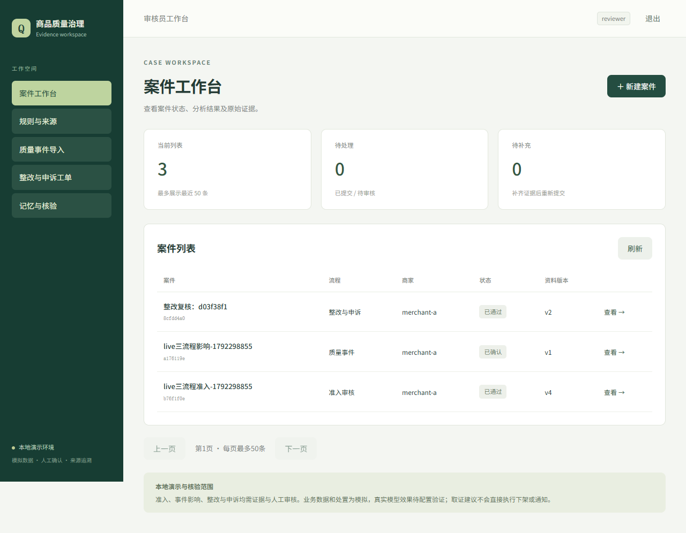
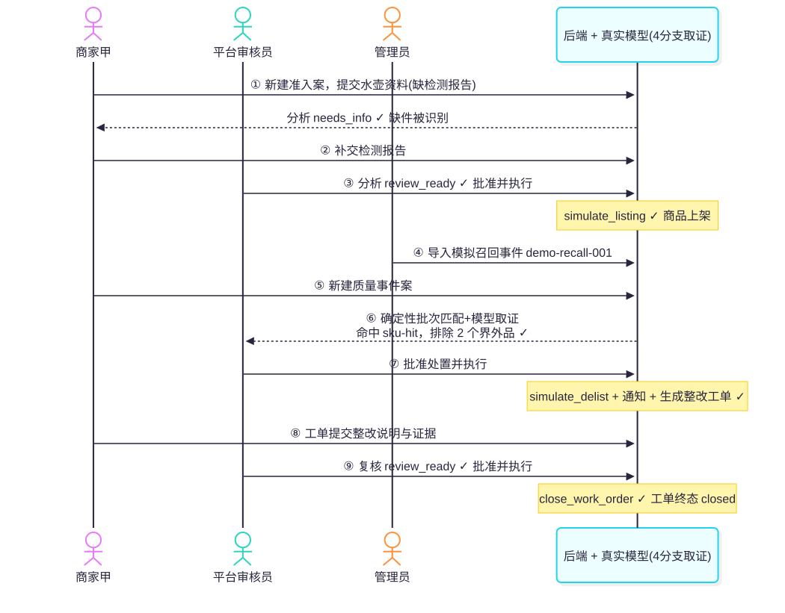

# Quality Governance Agent — 商品质量治理工作流

面向电商质量治理的本地作品集项目：把商品准入、质量事件影响分析和整改复核放进带证据链、角色权限和人工审批的工作流。使用 FastAPI、SQLAlchemy、LangGraph、Vue 3 与 PostgreSQL；模型负责取证和解释，确定性规则与人工审核共同约束处置。



## 三条业务流程

| 流程 | 核心行为 | 边界 |
|---|---|---|
| 商品准入 | 规则、商品、材料、历史四分支取证；缺件补件后重新分析 | 材料可追溯不代表真实性已获认证 |
| 事件影响 | 按品牌、型号、生产区间匹配商品、批次与订单 | 不确定范围保留 unknown；抽检不自动等于召回 |
| 整改复核 | 新证据绑定原工单；复核后关闭工单 | 关闭不会自动恢复上架，恢复需重新准入 |

审核按资料版本与分析 run 绑定，来源变化会使旧结论失效。批准和执行分开，执行幂等且仅产生模拟效果。商家只能读取所属案件；审核员审批；管理员导入目录与来源。

关系抽取保留原文出处与证据 ID；未来供货承诺不能确认为已经供货。整改与影响分析保留分支风险、缺失项及非就绪结论，不能将其汇总成 `review_ready`。




## 本地启动（Fake 演示，无需 API Key）

准备 Docker Desktop、Python 3.12、Node.js 22.12 或更新版本。以下命令均在项目根目录执行；先安装依赖，再双击 `START-DEMO.cmd`，或运行最后一行：

```powershell
python -m venv .venv
.\.venv\Scripts\python.exe -m pip install -r requirements.lock.txt
npm --prefix frontend ci
powershell -NoProfile -ExecutionPolicy Bypass -File scripts/start-demo.ps1 -PostgresPort 56543
```

访问 <http://127.0.0.1:5175>。启动器创建带工作区归属标记的专用 `quality_demo` 数据库，并导入自建演示目录；模型回答使用固定协议替身，外部模型请求为零。停止：`powershell -File scripts/stop-demo.ps1`。

演示账号为 `merchant-a`、`merchant-b`、`reviewer`、`admin`，密码均为 `demo-only`。这是本地模拟环境，不应直接部署为公网服务。

首次走查顺序：

1. 管理员进入「规则与来源」，确认演示目录已导入；手动启动服务时，**先导入演示目录，再创建商品案件**。
2. 商家甲创建准入案，选择 `sku-hit`，上传模拟证书和标签，先不传检测报告；提交后由审核员分析，预期 `needs_info`。
3. 商家补传模拟检测报告，重新提交并分析；达到 `review_ready` 后由审核员批准当前版本，再执行模拟上架。
4. 商家创建质量事件案，选择 `demo-recall-001`；审核员分析命中/排除范围，批准后执行模拟下架、通知和生成工单。
5. 商家在工单中创建整改复核案，提交说明和新证据；审核员复核、批准并执行关闭。工单关闭不自动上架。

上传文件可使用 `data/demo/materials/` 中的自建样例；检测报告补件与整改取证的文本场景见验证脚本中的合成材料。

## 验证与可信范围

```powershell
.\.venv\Scripts\python.exe -m ruff check backend scripts tests
.\.venv\Scripts\python.exe -m pytest -q -p no:cacheprovider --basetemp=data/runtime/tests
npm --prefix frontend run build
```

SQLite 测试覆盖协议替身、证据校验、权限隔离、版本失效、审批与模拟处置，以及分支风险和关系清理负例。前端构建包含 TypeScript 检查。CI 执行这三项。PostgreSQL 专属测试仅在设置独立的 `TEST_DATABASE_URL` 时执行；默认跳过不代表已验证 PostgreSQL。另一个可选 LangExtract 适配测试在未安装实验依赖时跳过。

`scripts/verify-live-threeflows.py` 是针对运行中真实模型后端的串联验证：缺检测报告→补件→模拟上架→事件处置→整改关闭，包含审核角色对应的审批 API 操作。它要求四分支协议完成，首轮还必须明确返回 `document:test_report`；缺件与协议失败分别检查。运行会调用付费模型并写入模拟案件，应在隔离环境中自行选择执行：

```powershell
.\.venv\Scripts\python.exe scripts/verify-live-threeflows.py --output data/runtime/threeflows.json
```

`scripts/verify-workflows-live.py` 则是三个**独立合成案件**的分支集成探针；整改前置批准/工单由夹具构造，不证明三流程串联审批和处置闭环。`--prepare-only --repetitions 1` 只准备夹具，不调用模型。

公开包不分发历史整轮实验日志和第三方原件。`tests/fixtures/` 中少量脱敏片段仅用于复现解析、关系与查询边界，不能作为真实模型质量或统计正确率的证据。费用计算使用固定测试价目快照，不代表当前报价或已核对账单。历史截图仅展示界面，不证明当前代码的模型效果。本次发布核验记录见 [VALIDATION.md](VALIDATION.md)。

## 可选真实模型模式

复制 `.env.example` 为仅存本地的 `.env.live`，填写 `AGNES_API_KEY`、`JWT_SECRET`，设置 `MODEL_MODE=live`。模型配置以环境示例和当前实现为准；本次发布收尾不发起真实模型请求。

```powershell
docker compose up -d postgres
.\.venv\Scripts\python.exe -m alembic upgrade head
.\.venv\Scripts\python.exe scripts/run-live-backend.py --postgres-port 55432
npm --prefix frontend run dev
```

后端默认使用本机 55432 的开发库，前端访问 <http://127.0.0.1:5173>。首次使用同样先由管理员导入演示目录。迁移命令默认指向示例数据库；更改端口或数据库时须同步设置 `DATABASE_URL`。


